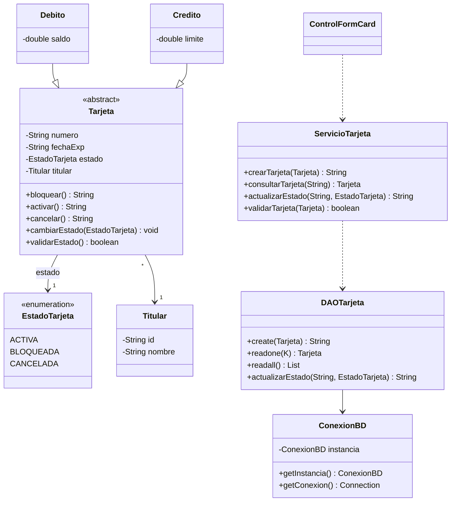

# Parcial 2 – Práctica aplicada: Gestión de Tarjetas

Aplicación de escritorio desarrollada en **JavaFX** con persistencia en **MySQL**, que permite crear y consultar tarjetas de **débito** y **crédito** asociadas a un titular. Este repositorio incluye la implementación de la **Historia de Usuario HU-01: asignar un estado a una tarjeta**.

---

## Tabla de contenido

1. [Tecnologías](#tecnologías)
2. [Arquitectura del proyecto](#arquitectura-del-proyecto)
3. [Historia de usuario HU-01](#historia-de-usuario-hu-01)
4. [Estimación](#estimación)
5. [Tareas técnicas](#tareas-técnicas)
6. [Modelo de datos](#modelo-de-datos)
7. [Instalación y ejecución](#instalación-y-ejecución)
8. [Pruebas](#pruebas)
9. [Cómo probar la HU-01 en la aplicación](#cómo-probar-la-hu-01-en-la-aplicación)

---

## Tecnologías

| Componente | Versión |
|---|---|
| Java | 11 |
| JavaFX | 13 |
| MySQL | 8.x (MySQL Connector/J 8.4.0) |
| Maven | 3.x |
| JUnit | 5.10.0 |
| dotenv-java | 3.0.0 (lectura de credenciales desde `.env`) |

---

## Arquitectura del proyecto

El proyecto sigue una estructura por capas, con el paquete base `co.edu.poli.examen2_Soto`:

| Paquete | Contenido | Responsabilidad |
|---|---|---|
| `modelo` | `Tarjeta` (abstracta), `Debito`, `Credito`, `Titular`, `EstadoTarjeta`, `EstadoInvalidoException` | Entidades y reglas del dominio |
| `servicios` | `CRUD<T>`, `ConexionBD`, `DAOTarjeta`, `DAOTitular`, `ServicioTarjeta` | Acceso a datos y lógica de negocio |
| `controlador` | `ControlFormCard` | Controlador del formulario JavaFX |
| `vista` | `App` + `formCard.fxml` | Arranque de la aplicación e interfaz |

### Diagrama de clases (modelo y servicios)



---

## Historia de usuario HU-01

> **Como** analista de crédito,
> **quiero** asignar un estado a una tarjeta
> **para** controlar si puede ser utilizada.

### Criterios de aceptación

| # | Criterio | Cómo se cumple |
|---|---|---|
| 1 | La tarjeta debe poder encontrarse en uno de los estados: **Activa**, **Bloqueada** o **Cancelada**. | Enumeración `EstadoTarjeta` |
| 2 | El estado debe almacenarse de forma **persistente** en la base de datos. | Columna `estado` (`ENUM`) en la tabla `tarjeta` y `DAOTarjeta` |
| 3 | El estado debe **visualizarse** en el formulario principal. | Pestaña *Consultar*: texto del resultado y etiqueta "Estado: …" |
| 4 | El estado es un campo **obligatorio** al crear una tarjeta. | `ComboBox` de estado con validación en `ControlFormCard` y constructor de `Tarjeta` |
| 5 | **No** se puede guardar una tarjeta sin un estado válido. | Validación en `Tarjeta`, `ServicioTarjeta`, `DAOTarjeta` y restricción `NOT NULL` en la BD |

---

## Estimación

| Concepto | Valor |
|---|---|
| Puntos de historia | **5** (complejidad media: toca todas las capas y la base de datos) |
| Esfuerzo estimado | **12,5 horas** |
| Prioridad | Alta |

---

## Tareas técnicas

| # | Tarea | Capa | Estimación | Estado |
|---|---|---|---|---|
| 1 | Crear la enumeración `EstadoTarjeta` y la excepción `EstadoInvalidoException` | Modelo | 1 h | ✅ |
| 2 | Cambiar `Tarjeta`, `Debito` y `Credito` para usar `EstadoTarjeta` (validación en constructor y setters; agregar `cancelar()`) | Modelo | 1,5 h | ✅ |
| 3 | Modificar la tabla `tarjeta`: columna `estado` como `ENUM('ACTIVA','BLOQUEADA','CANCELADA') NOT NULL`, y actualizar `ScriptDB.sql` | Base de datos | 1 h | ✅ |
| 4 | Crear script de migración `MigracionHU01_estado.sql` para bases existentes | Base de datos | 0,5 h | ✅ |
| 5 | Actualizar `DAOTarjeta`: guardar y leer el estado, y agregar `actualizarEstado` | Servicios | 2 h | ✅ |
| 6 | Crear `ServicioTarjeta` con la validación "no guardar sin estado válido" | Servicios | 1 h | ✅ |
| 7 | Agregar `ComboBox` obligatorio de estado en la pestaña *Crear* (`formCard.fxml` y `ControlFormCard`) | Vista / Controlador | 1,5 h | ✅ |
| 8 | Mostrar el estado en la pestaña *Consultar* y permitir actualizarlo | Vista / Controlador | 1,5 h | ✅ |
| 9 | Actualizar y crear pruebas unitarias y de integración (`TestTarjeta`, `TestServicioTarjeta`, `TestDAOTarjeta`) | Pruebas | 2 h | ✅ |
| 10 | Documentar en el `README.md` y grabar el video de demostración | Documentación | 0,5 h | ✅ |
| | **Total** | | **12,5 h** | |

---

## Modelo de datos

Estrategia de herencia por **tablas unidas** (una tabla por clase):

| Tabla | Campos principales |
|---|---|
| `titular` | `id` (PK), `nombre` |
| `tarjeta` | `numero` (PK), `fecha_exp`, **`estado`** (`ENUM('ACTIVA','BLOQUEADA','CANCELADA') NOT NULL`), `titular_id` (FK → `titular.id`) |
| `tarjeta_debito` | `numero` (PK y FK → `tarjeta.numero`), `saldo` |
| `tarjeta_credito` | `numero` (PK y FK → `tarjeta.numero`), `limite` |

---

## Instalación y ejecución

### 1. Requisitos previos

- JDK 11 o superior
- Maven instalado (`mvn -v` debe mostrar una versión)
- MySQL Server y MySQL Workbench

### 2. Crear la base de datos

En MySQL Workbench abre el archivo `JavaFxMySQL-main/ScriptDB.sql` y ejecútalo completo. Esto crea la base `examen2_soto`, sus tablas y datos de ejemplo.

Si ya tenías la base de una versión anterior y quieres conservar tus datos, ejecuta en su lugar `JavaFxMySQL-main/MigracionHU01_estado.sql`.

### 3. Configurar las credenciales

Crea un archivo llamado `.env` dentro de la carpeta `JavaFxMySQL-main/examen2_Soto/` (junto al `pom.xml`):

```
DB_URL=jdbc:mysql://localhost:3306/examen2_soto?useSSL=false&serverTimezone=UTC&allowPublicKeyRetrieval=true
DB_USER=root
DB_PASSWORD=tu_contraseña
```

> El archivo `.env` contiene credenciales, por lo que **no debe subirse al repositorio**. Agrégalo al `.gitignore`.

### 3.1 Clase principal en `pom.xml`

La clase de arranque `App` está en el paquete `vista`. En el `pom.xml`, la configuración del plugin `javafx-maven-plugin` debe quedar:

```xml
<mainClass>co.edu.poli.examen2_Soto/co.edu.poli.examen2_Soto.vista.App</mainClass>
```

### 4. Ejecutar la aplicación

Desde una terminal ubicada en `JavaFxMySQL-main/examen2_Soto/`:

```
mvn clean javafx:run
```

---

## Pruebas

Desde la misma carpeta (`JavaFxMySQL-main/examen2_Soto/`):

```
mvn test
```

| Prueba | Tipo | Qué verifica |
|---|---|---|
| `TestTarjeta` | Unitaria | Cambio de estado (activar, bloquear, cancelar), rechazo de estado `null` y `fromString` |
| `TestServicioTarjeta` | Unitaria | El servicio rechaza guardar o actualizar sin estado válido |
| `TestDAOTarjeta` | Integración (usa MySQL) | Guardar tarjetas con estado, consultarlas y actualizar el estado |
| `TestDAOTitular` | Integración (usa MySQL) | Lectura de titulares |

Para ejecutar solo las pruebas que **no** necesitan base de datos:

```
mvn test -Dtest="TestTarjeta,TestServicioTarjeta"
```

> Las pruebas de integración crean tarjetas en la base de datos. Para repetirlas con la base limpia, ejecuta `DROP DATABASE examen2_soto;` y vuelve a correr `ScriptDB.sql`.

---

## Cómo probar la HU-01 en la aplicación

1. **Estado obligatorio:** en la pestaña *Crear*, ingresa un número, elige un titular y deja el estado sin seleccionar. Al pulsar *Creación* aparece una alerta y la tarjeta no se guarda.
2. **Crear con estado:** selecciona un estado (por ejemplo, *Bloqueada*) y pulsa *Creación*. La tarjeta se guarda correctamente.
3. **Visualizar el estado:** en la pestaña *Consultar*, ingresa el número de la tarjeta y pulsa *Consulta*. El estado aparece en el resultado y en la etiqueta "Estado: …".
4. **Cambiar el estado:** elige un nuevo estado en la lista y pulsa *Actualizar estado*. El cambio se refleja en pantalla.
5. **Persistencia:** cierra y vuelve a abrir la aplicación, y consulta la misma tarjeta. El estado se conserva. También puedes verificarlo en Workbench con `SELECT * FROM tarjeta;`.

---

## Autor

**Deivid** – Politécnico Grancolombiano
